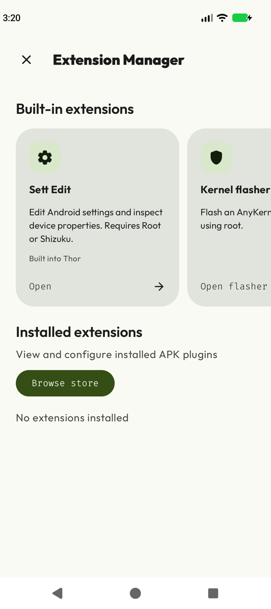
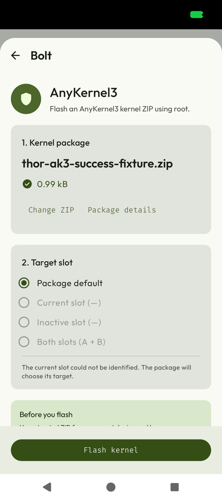

# AnyKernel3 kernel flasher

Status: implemented on `feat/anykernel3-flasher`; repository gates passed on
2026-10-16. Harmless Magisk emulator checks are recorded below; real kernel and
physical A/B partition acceptance checks remain pending. This document does not
certify a successful device flash or Google Play approval.

Validation command:

```sh
./gradlew test lintFossDebug lintStoreRelease --max-workers=1 '-Pkotlin.daemon.jvmargs=-Xmx6g -XX:+UseG1GC'
```

Both FOSS and Store debug suites passed 3,662 tests each. The 83 new flasher and portable installer tests
cover malformed archives, recovery decisions, slot mapping and conservative
package support detection, ordered Both passes, stop-on-failure behavior,
partial receipt recovery, root admission races, portable intent and content routing,
single-copy staging, and a harmless host fixture for
the installer command's quoting, bounded output and exit status. The larger heap
and single worker avoid compiler heap exhaustion with the default settings.
These host tests never acquire root or flash a device. Emulator checks below
exercise Magisk using packages that do not write partitions. Both requested lint tasks passed.

The reference flow was inspected in the local KernelSU-Next fork at commit
`bbe5db8f4cdb128549ccd9e9a589b3f68796d04c`: `manager/app/src/main/AndroidManifest.xml`
routes the flash aliases through `MainActivity`, `Flash.kt`, and
`ui/util/KsuCli.kt` (`flashAnyKernelZip`). Thor uses the same recovery installer
arguments (`3 1`) and `AKHOME` convention with its own validation and lifecycle
handling; no KernelSU or BusyBox binary is bundled.

## Scope

The kernel flasher is intended for both the `foss` and `store` builds. Its entry
point belongs in Extensions alongside the built-in settings editor. The portable
installer also accepts a ZIP opened or shared from another app and uses the
**Bolt** title after recognizing AnyKernel3. It accepts a
user-selected local AnyKernel3 ZIP through Android's document picker. It does not
provide a kernel catalogue, download ZIPs or executable helpers, or install a root
manager.

Only AnyKernel3 packages are in scope. Generic recovery ZIPs, ROMs, raw boot images,
and Magisk/KernelSU/APatch module ZIPs are not supported by this feature. An
AnyKernel3 ZIP is a kernel installer package; the feature must not present it as
a general root module installer.

"Local ZIP" describes user-initiated file selection without an in-app kernel
downloader. A document provider may supply cloud-backed content; the picker
alone does not prove that the selected bytes have never been downloaded.

Extensions' existing privilege requirement is a navigation prerequisite. Flashing
additionally requires actual root access and a supported BusyBox executable
already provided by the user's installed root manager. Shizuku, Dhizuku, or a
remembered root preference alone do not authorize or enable flashing. Root and
BusyBox availability must be checked before a flash starts, with an explanation
when either is unavailable.

Both distribution flavors must use the same documented eligibility rules. Root
availability must never be used to detect reviewers or conceal functionality
from them. No review-specific switch, delayed unlock, or hidden enabling path is
part of the design.

## User flow and limits

1. Open Extensions and select Kernel flasher.
2. Select a local ZIP through the system document picker.
3. Inspect and validate the ZIP before enabling installation. Reject unsupported
   packages, malformed archives, and unsafe archive paths.
4. Choose package default, current, inactive, or both slots when the package and device
   report standard A/B support. Show the selected target and file; explain that
   its installer scripts will execute
   with root access and may modify boot-related partitions. Require an explicit
   confirmation for that file before starting.
5. Display progress and installer output in Thor's shared `TermLoggerContent`,
   with wrapped lines and automatic scrolling. Report the observed
   process result, retain useful diagnostic output, and distinguish failure from
   an interrupted operation whose outcome is unknown.
6. Leave rebooting to a separate, explicit user action after a successful result.
   Do not reboot automatically.

Recognizing an AnyKernel3 layout is a format check, not a security audit or a
device compatibility guarantee. Package scripts can execute arbitrary commands
as root and can do more than install a kernel. A SHA-256 digest identifies the
selected bytes if displayed; it does not establish that the package is trusted.
The user must obtain a package from a trusted source that supports their exact
device and software configuration.

Slot selection uses AnyKernel3's `SLOT_SELECT=active` or `inactive` contract.
Package default clears any inherited override. Explicit choices require a known
`_a`/`_b` current slot and an unambiguous standard slot declaration and block
configuration in the package. Unsupported or custom configurations retain
package default. The requested selection, package hash, and observed current slot
are bound to confirmation and rechecked before dispatch. The receipt and log
record the requested target. This is a request to trusted package code; arbitrary
scripts can override it. Thor never changes the slot selected for the next boot.
Use the inactive slot only when it contains a compatible system.

### Both slots

The Xiaomi reference scripts (`macos_install_upgrade.sh` in
`xiaomi.eu_ONYX_OS3.0.306.0.WOLCNXM_16_dd576ea442`) flash `boot_ab`,
`init_boot_ab`, `vendor_boot_ab` and `recovery_ab` using fastboot. AnyKernel3
does not have an equivalent generic "both" flag. Thor expands Both into two
complete installer passes: current (`active`), then inactive (`inactive`).
Thor does not copy Xiaomi's slot activation or ROM installation commands.

Before either pass starts, Thor prepares separate verified ZIP copies,
installer directories, BusyBox bootstraps and root shells. Each pass patches
from its own target through the package installer. The second run never reuses
the first run's extracted tree or patched image. Immediately before each pass,
Thor rechecks the ZIP hash, current slot, boot identity and available space.
A failure, lost result or preparation error stops the plan without retrying.
The durable receipt contains the planned targets and each observed pass result;
process recovery preserves completed results and marks an unfinished pass unknown.
An interrupted plan is never resumed automatically.

Both requires an additional acknowledgement: the package author must support
repeated installation on both installed systems. The entire installer runs
twice, including any shared data or module changes. Both kernels can be replaced,
removing the untouched fallback. AK3 compatibility checks may inspect only the
currently mounted ROM; they do not establish inactive-system compatibility.
Some package scripts may target unsuffixed/shared partitions or override slot
selection. The UI and log therefore describe requested targets, not verified
partition writes. Failure may leave only one slot updated. There is no atomic
transaction, automatic rollback, retry, resume or next-boot slot switch.

### Operation lifecycle

A successful installer exit status does not prove that the device will boot,
that every partition is correct, or that the new kernel works. A failed flash can
require recovery outside Thor. Do not promise automatic backup, rollback, or
recovery unless those capabilities are separately implemented and verified.

The operation must survive ordinary screen recreation without starting a second
flash. Backgrounding, process interruption, or lost output must never trigger an
automatic retry. If Thor cannot establish whether a previous operation completed,
show an interrupted/unknown outcome and require the user to assess the device
before any new explicit operation. Do not present interruption as a confirmed
safe rollback.

Implementation details: Thor requires nonempty `anykernel.sh`,
`META-INF/com/google/android/update-binary`, and `tools/ak3-core.sh`. It rejects
root `module.prop`, links, ambiguous or unsafe paths, mismatched local/central ZIP
headers, duplicate entries, invalid checksums, encrypted archives and ZIP64.
Limits are 512 MiB compressed, 2 GiB expanded, 8,192 entries and a 2 MiB installer.
Before dispatch it checks free space for the expanded archive plus 512 MiB of
working space; the package may require more. SHA-256 is checked again against the
private staged copy immediately before execution.

The foreground service owns a dedicated Odin shell without a mount-master
request. It uses the existing root manager's BusyBox to bootstrap the package;
no BusyBox binary is bundled. A FIFO and a BusyBox ash reader cap output at 1,024 bytes before
Odin reads each line. The reader flushes short lines immediately and retains the
installer's exit code; BusyBox `fold` was removed after emulator testing exposed
its pipe buffering. Logs keep at most 1 MiB on
disk and the most recent 500 lines in the screen. The write-ahead receipt lives
in Android's no-backup directory. Thor blocks another flash during the same boot
after dispatch, including after failure or success. An interrupted result becomes
unknown; only a different kernel boot identity releases that block. Missing or
corrupt recovery metadata fails closed. The exported portable installer accepts
documents for preview through VIEW/SEND; it never accepts an intent to flash,
select slots or bypass confirmation. The flash service remains unexported.
There is no cancellation action, automatic retry or automatic reboot in Thor's flow.

### Portable installer / Bolt

Home's **Install from File** opens the same portable installer Activity as external
VIEW/SEND documents, so both paths use the same classification and lifecycle.
The existing bounded installer staging path reads a shared content URI once.
It checks the staged ZIP for root-level AnyKernel3 markers, then applies the full
AnyKernel3 validator. A malformed kernel candidate is rejected rather than sent
to the APK fallback. Valid APKs and app bundles retain the existing analyzer,
metadata, permission choices and installation UI. Filenames and MIME types do
not determine the kernel route by themselves.

Recognized kernels open a Bolt sheet backed by the same controller, slot choices,
confirmation and shared terminal as Extensions. The controller takes its own
private copy and verifies the classified hash before showing it for confirmation.
The installer refreshes root availability before opening Bolt. Without confirmed
root, it deletes the staged kernel and shows a root-required message in Thor
Installer; Shizuku, Dhizuku and a remembered root preference cannot enable Bolt.
Ordinary APK and app-bundle previews remain available without root and do not
request an additional root check. The kernel controller checks root again before
import and flashing.
Rotation retains the import job. After process recreation, an undispatched
preview is imported again; a matching dispatched receipt is shown without
replaying the installer. A different ZIP cannot replace dispatched work.

The no-retry and no-automatic-reboot requirements govern Thor's own flow.
Package code runs with root and may itself reboot or disrupt the device; the
installer must not be described as a sandbox that prevents such commands.

## Emulator validation (2026-10-16)

The local AVD `Thor_Magisk_API37_2` uses Android 17 / SDK full **37.2**,
the ARM64 Google APIs 16 KB image revision 6, and Magisk **30.7 (30700)**.
SELinux is enforcing. During app tests, ADB runs as UID 2000 and Thor's
installer reports UID 0 with context `u:r:magisk:s0`. Its private patched system
image is kept outside the repository; the shared SDK image is unchanged.
The registered AVD is available in Android Studio and can be started with:

```sh
/Users/trinadhthatakula/StudioProjects/Thor-test-emulator/start-emulator.sh
```

The same directory contains fixture ZIPs, their source scripts inside each ZIP,
logs, receipts and screenshots. Fixtures print identity/progress and exit 0 or
17; they never open block devices or install a kernel. Verified behavior:

- Magisk root admission, invalid root-module ZIP rejection, and recovery from a
  root refresh overlapping the document-picker return.
- Live output in the shared `TermLoggerContent`, including output observed
  before the installer exits, rotation and background completion.
- Exit code 17 retained, no automatic retry or reboot, same-boot lock, and
  completed failure restored after force-stop/relaunch without replay.
- An explicit emulator reboot preserves Magisk and releases the flash lock
  after a different boot identity is observed.
- Zero top app bar insets and additional bottom spacing with both gesture and
  three-button navigation. The outer navigation padding is consumed before the
  flasher handles its own navigation-bar insets.
- Both acknowledgement blocks dispatch until both checkboxes are selected.
- Both success with simulated current A: requested `_a` then `_b`, both exit 0.
  Each fixture deletes its own ZIP, demonstrating that the second pass has an
  independent copy and working tree.
- Partial failure with simulated current B: `_b` exits 0, then `_a` exits 17.
  The receipt retains both results and the UI shows the partial-result warning,
  including after force-stop/relaunch; the receipt is unchanged and no pass replays.
- First-pass failure with simulated current A: `_a` exits 17; `_b` is never
  dispatched and the log explicitly records that remaining passes were not started.
- Opening an AnyKernel3 document and sharing it from Android Files both show
  **Bolt**. The preview survives portrait/landscape rotation. A harmless fixture
  completes through Bolt with live shared terminal output; rotation and Back
  during execution do not cancel or replay it. The receipt records one successful
  pass with exit code 0. Force-stopping and reopening the same shared ZIP restores
  the completed Bolt result; the receipt remains unchanged and no pass replays.
- APK and APK-bundle ZIP previews retain **Thor Installer**, package metadata,
  permissions and installation-mode controls. The preview checks do not install
  or update those apps. An unsupported root-module ZIP is rejected.
- Home's **Install from File** opens **Bolt** for AnyKernel3 after a fresh root
  check. Closing it and choosing a different kernel displays the newly selected
  package. With Thor's Magisk grant denied, both Home picks and external document
  opens show the root-required error without entering Bolt; an APK still opens
  its existing install/update preview. The Magisk grant was restored afterwards,
  and ADB returned to UID 2000. These routing checks do not dispatch a flash.

The AVD does not have real A/B boot partitions. Both-slot tests temporarily
simulate read-only slot properties using Magisk `resetprop`; this checks Thor's
orchestration and UI, not actual partition routing or compatibility. Real
AnyKernel3 flashing, subsequent kernel boot, inactive-ROM compatibility and
other root managers still require recoverable hardware validation. Runtime
checks above use FOSS debug. Both signed release APKs were also built: FOSS is
4,986,364 bytes (4.76 MiB), and Store is 5,198,785 bytes (4.96 MiB).
A Store release-mode preview (`DEBUG=false`, minified, resource-shrunk) was
installed and launched over the existing physical-device test app. It uses the
test app's ID and signing key because the installed Play release has a different
certificate. This confirms installation and startup only; Store kernel execution
and the hardware acceptance checks above remain pending. Release build version
overrides were local; repository version settings are unchanged.

### Screenshots

These screenshots show the FOSS debug UI on the Magisk emulator with a harmless
fixture ZIP. The emulator has no physical A/B boot partitions.

| Built-in extensions | Portable Bolt preview |
| --- | --- |
|  |  |

## Google Play policy assessment

The policy pages below were checked during the feature investigation on
2026-10-16. Enforcement for this exact implementation is uncertain. These rules
do not establish that every root utility is banned, and they do not establish
that an AnyKernel3 flasher will be accepted.

- [Device and Network Abuse](https://support.google.com/googleplay/android-developer/answer/16559646?hl=en)
  says an app "may not download executable code" outside Google Play. It also
  restricts runtime interpreted code that can enable policy violations, damaging
  or unauthorized device interference, and code that introduces or exploits
  security vulnerabilities. User-selected document import avoids a built-in
  kernel downloader, but the policy provides no explicit exemption
  for unrestricted root scripts or native tools in imported kernel ZIPs. Do not
  assume the interpreter exception covers those operations.
- [Deceptive Behavior](https://support.google.com/googleplay/android-developer/answer/17006354?hl=en)
  states: "Techniques to evade app reviews are not allowed." It prohibits hidden
  or undocumented functionality and requires accurate descriptions of app
  behavior. It also requires consent for device feature changes and requires
  those changes to be easily reversible. Kernel recovery that needs external
  tools presents an unresolved issue under the reversibility requirement. Clear
  warnings are useful but do not waive the policy.
- [Malware](https://support.google.com/googleplay/android-developer/answer/9888380?hl=en-GB)
  distinguishes non-malicious from malicious rooting. Informed user consent does
  not excuse other harmful behavior. The policy lists disabling SELinux as an
  example of elevated privilege abuse. Merely checking that a ZIP is AnyKernel3
  cannot establish that all its commands comply with these rules.

The agreed implementation scope includes both builds and transparent in-app
documentation. This work does not change the store listing or screenshots. There
is no blanket requirement in the cited policy to give every secondary feature a
dedicated screenshot. Nevertheless, Google requires accurate metadata and
prominent disclosure when core functionality differs by device parameters. An
in-app description or review note is not a guarantee that those requirements
have been met. Assess the final behavior and release disclosures before a Store
submission; do not treat an unrooted review device as evidence of compliance.

## Reviewer access information

Before submission, verify these instructions against the completed Store build
and include the relevant access information in Play Console's review/app-content
instructions. Google provides fields for special access instructions; see
[Prepare your app for review](https://support.google.com/googleplay/android-developer/answer/9859455?hl=en-GB).
The instructions must describe the real feature and prerequisites even when a
review device cannot meet them.

Suggested reviewer note, to complete with verified build and device details:

> This build includes an AnyKernel3 kernel ZIP flasher in Extensions. It requires
> an already rooted Android device, an explicit root grant to Thor, and supported
> BusyBox supplied by the installed root manager. Shizuku and Dhizuku alone cannot
> flash a kernel. The feature does not root the device or download kernels. It
> executes a user-selected local AnyKernel3 package with root access after an
> explicit confirmation and can modify boot-related partitions. These same
> prerequisites and behavior apply to every user, including reviewers. Open Thor,
> grant its requested root access in the installed root manager, open Extensions,
> and select Kernel flasher. On a device without the prerequisites, flashing is
> unavailable. Opening or sharing an AnyKernel3 ZIP from a file manager also opens
> the portable installer as Bolt, with the same confirmation and root requirements.
> A demonstration and the tested device, firmware, root manager,
> package source, and package digest are provided with this submission. Use only
> a package verified for the review device; the demonstration package is not
> universally compatible. Thor does not reboot automatically.

Do not submit that note with an unverified demonstration claim. Prepare a video
on a recoverable test device showing:

- The exact Store build, device model, firmware/kernel version, and root manager
  version, followed by the root grant and navigation to the feature.
- Selection of a known compatible local AnyKernel3 ZIP, its identity, validation,
  the root-script warning, and explicit confirmation.
- Progress/output, the resulting status, and the separate reboot action. Show
  successful boot and the resulting kernel version only if actually verified.
- The behavior with no root, missing BusyBox, and an unsupported ZIP. Identify
  whether each example is from a separate test run.

Provide clear reproduction steps and a demonstration for environments where
root access is unavailable. A video does not replace any access or additional
information Google requests. Do not instruct reviewers to bypass a check that
ordinary users must satisfy, and do not provide a differently behaving review
build.

## Acceptance checklist

Record the build/commit, flavor, device and firmware, root manager and BusyBox
versions, package source/digest, observed output, and result for device checks.
Archive relevant logs without personal data. Run destructive flash scenarios only
on a test device with a known external recovery procedure.

### Implementation and build checks

- [ ] Both `foss` and `store` expose the documented Extensions entry with the
      same eligibility behavior; backend flashing requires live root access.
- [ ] Only local AnyKernel3 ZIPs are accepted; archive checks reject unsupported
      layouts, malformed data, and path traversal before execution.
- [ ] BusyBox is obtained from a supported existing root manager; absence fails
      clearly before a flash and does not initiate a download.
- [ ] Confirmation is bound to the selected package; one user action starts at
      most one confirmed operation (with two planned passes for Both) and repeated taps cannot start concurrent flashes.
- [ ] Logs and terminal states distinguish success, failure, and interruption
      with an unknown result. There is no automatic retry or automatic reboot.
- [x] Run repository PR gates: `./gradlew test lintFossDebug lintStoreRelease`.
      Passed with the resource overrides recorded above; no lint errors or warnings.

### Device checks

- [ ] **Valid AnyKernel3:** flash a known compatible package on a recoverable
      rooted test device; inspect output, explicitly reboot, confirm successful
      boot and the expected kernel, and record the supported configuration.
- [ ] **No root:** test no root manager, denied/revoked root, and Shizuku/Dhizuku
      without root; no package command or partition write occurs.
- [ ] **Missing BusyBox:** root is available but the required helper is not;
      show an actionable failure before installer execution.
- [ ] **Invalid ZIP:** test a non-ZIP, corrupt ZIP, generic recovery ZIP, root
      module ZIP, and unsafe entry paths; reject without executing package code.
- [ ] **Rotation and background:** rotate or recreate the screen and background
      the app during a controlled operation; preserve the visible operation and
      prevent duplicate execution when returning.
- [ ] **Interruption/unknown result:** exercise loss of the app process or its
      connection to the running operation using a controlled harness or a
      recoverable test setup. Reopening must not replay the installer, claim
      success without evidence, or imply a rollback occurred.
- [ ] **Failure:** observe a controlled installer failure; preserve the failure
      and useful output without retrying or rebooting automatically.
- [ ] **No auto reboot:** successful, failed, and interrupted outcomes never
      reboot without a separate user action; a reboot request is not described
      as proof that the new kernel will boot.
- [ ] Repeat relevant behavior checks in both flavors and document any device
      or root-manager configurations that remain unverified.

### Store submission preparation

- [ ] Confirm final behavior against the current policies and record unresolved
      questions; no claim of Google Play approval is made without actual review.
- [ ] Verify and complete reviewer instructions and demonstration using the
      release candidate, including all privilege and helper prerequisites.
- [ ] Review metadata and disclosure accuracy for the actual release without
      relying on reviewers being unable to access privileged functionality.
